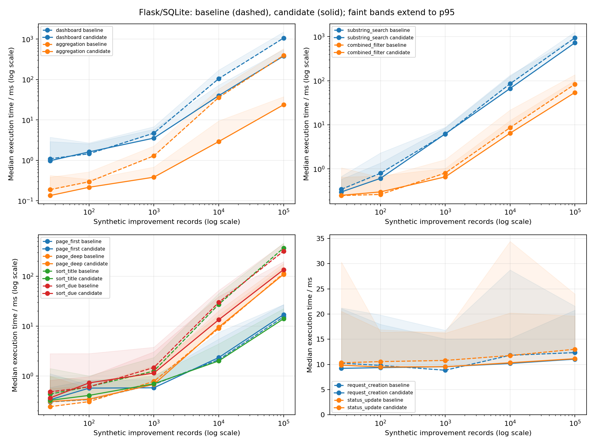
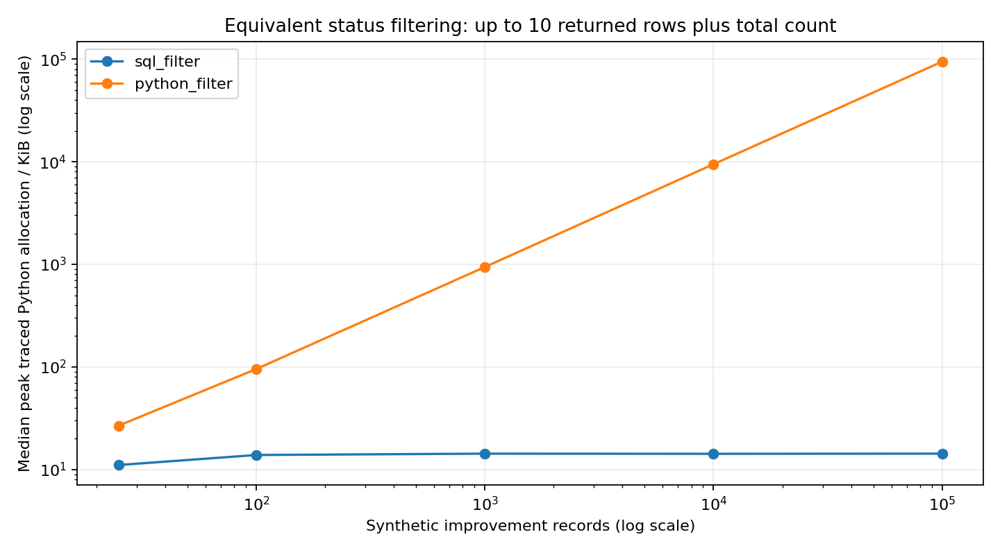

# Performance evaluation

This is an empirical evaluation of the existing Flask/SQLite Service Improvement Register for a Level 6 Advanced Programming portfolio. All data is synthetic. Measurements describe this local machine and workload, not production capacity or bank infrastructure. The retained results distinguish the initial evaluation from a confirmation run with reversed index-phase order.

## Scope and inspection

Reviewed `app/db.py` (schema, additive migrations, connections and indexes), `app/repository.py` (SQL, paging, metrics, transactions), `app/services.py` (validation, dashboard orchestration and status transitions), `app/routes.py`, authentication, the existing test suite and `scripts/benchmark.py`. The original benchmark only measured three mean durations at 10,000 rows. This work extends that entry point rather than introducing a second benchmark framework.

The existing `(archived,status)` index supports status selection; `(item_id,id)` supports activity history. An integer primary key locates requests for updates. Dashboard generation calls summary aggregation, a counted first page, metrics, trend aggregation and recent activity. Both `/` and `/requests` currently calculate dashboard data. Search uses literal `instr(lower(...),lower(?))`, not SQL wildcard expansion. All filter values remain bound parameters and sort expressions remain allowlisted.

## Reproduction (Git Bash, from the repository root)

```bash
./.venv/Scripts/python.exe -m pip install -r requirements-performance.txt
./.venv/Scripts/python.exe scripts/benchmark.py --output docs/performance-results/my-new-run
./.venv/Scripts/python.exe scripts/benchmark.py --reverse-phases --output docs/performance-results/my-confirmation-run
./.venv/Scripts/python.exe -m pytest --basetemp="./.pytest-tmp-reproduction" -p no:cacheprovider --cov=app --cov-report=term-missing
./.venv/Scripts/python.exe -m ruff check .
```

Use a new output directory for each run. The script refuses to replace completed results. The pytest base directory is disposable and must contain only test temporary files: pytest clears it on subsequent runs. In PowerShell, use `.\.venv\Scripts\python.exe` in place of `./.venv/Scripts/python.exe`. Keep the machine otherwise idle; do not run tests, app traffic and benchmarks simultaneously. Performance tools are optional and are separate from runtime requirements. `requirements-performance-lock.txt` records the complete installed dependency snapshot; use `pip install -r requirements-performance-lock.txt` when reproducing the captured environment. Platform wheel availability may differ.

For a quick harness check (not assessment measurements):

```bash
./.venv/Scripts/python.exe scripts/benchmark.py --sizes 25 100 --warmups 1 --repeats 3 --memory-repeats 1 --profile-repeats 1 --concurrency-rounds 1 --requests-per-worker 4 --output docs/performance-results/my-smoke-run
```

## Methodology and controls

* Five independently generated datasets: 25, 100, 1,000, 10,000 and 100,000 improvement rows, plus one synthetic creation activity per row. Seed 601; evenly selected category/priority/status values, approximately 10% archived rows, a `needle` substring every 20 rows, descriptions of approximately 250 characters, dates across 180 creation days, and a mixture of missing and populated due dates. Improvement-input hashes, actual row counts and baseline schema are exported. The checksum covers generated improvement values; synthetic activity timestamps use database current time, so it is not a byte-for-byte database checksum. The marker-every-20 and archive-every-10 rules correlate: only record 1 is an active substring match. Search therefore measures a rare-match scan workload, not a broad-match or independently distributed search workload. This is a controlled synthetic distribution, not an estimate of user behaviour; vary match frequency and archive correlation before generalising search results. Synthetic titles increase with row IDs, which gives title-index traversal unusually good physical row locality; indirect due-sort/trend benefits may differ with randomly ordered real titles.
* A new `TemporaryDirectory` contains every database. Every `create_app` call supplies a database path and a benchmark secret explicitly; environment `DATABASE` and the instance secret are not used. No demonstration or user database is opened. Connections are closed before Windows temporary-directory cleanup.
* Baseline retains existing application indexes but removes the two candidate indexes. Candidate adds a covering aggregation index on `(archived,status,priority)` and a title-order index on `(archived,title COLLATE NOCASE)`. Both phases run `ANALYZE`. This is an index comparison with identical query text and data, not a comparison against an unindexed database.
* Each operation has three untimed warm-ups, followed by 30 separately timed executions using `perf_counter_ns`, exported as milliseconds. Operation order is shuffled using seed 927 per repetition. Baseline/candidate phase order alternates across dataset sizes; `--reverse-phases` reverses that order at every size for a second independent run. This counterbalances order per size across two runs, but does not establish a confidence interval or remove all background-load effects. OS and SQLite caches are warm; no artificial cold-cache claim is made. Setup, index construction, statistics gathering and write cleanup are outside primary timing intervals. Initial index build/startup cost is not measured; adopting the indexes can increase first-start migration time. Python garbage collection remains enabled during timing.
* Ten operations: server-side dashboard data generation (same data calls as the route); case-insensitive substring search; combined status/priority/category filtering; first page; last active page via OFFSET; title sorting; due-date sorting; status/priority aggregation; validated creation with activity and commit; and validated status change with activity and commit. Writes are real committed transactions. Cleanup restores rows and activity after each sample; creation sequence values can advance, with no retained measured records. The first record's status and timestamp are restored. Tests verify cleanup.
* All read results are asserted equal across index phases. During the first equivalence trial, equal due dates produced different orderings under changed plans. Added `id` tie-breakers to title and due sorts. Both measured phases use this deterministic refinement, so the measured index effects do not estimate the performance impact of the tie-breaker. A regression test verifies stable, non-overlapping pages with tied values across both index configurations.
* Summaries contain mean, median, minimum, maximum and nearest-rank p95 (`sorted[ceil(.95*n)-1]`); 30 samples make p95 the 29th sample. Raw observations remain available. These are descriptive statistics, not confidence intervals or SLA estimates. Very small operations are particularly sensitive to scheduling and timer overhead.

## CPU and memory profiling

`cProfile` executes five iterations of all ten operations at the largest size, separately from uninstrumented timings. Binary `.prof` files support further inspection with `python -m pstats FILE`. Readable reports list the top 35 functions by cumulative elapsed execution time and top 20 by call count, including primitive/total call counts, self time, cumulative time and per-call time. Cleanup is included in these profiling workloads, so transaction/commit totals include cleanup commits. Profile timings must not be substituted for primary benchmark timings. cProfile does not explain SQLite's internal native execution or distinguish CPU from time blocked on I/O.

`tracemalloc` starts after `gc.collect()` for each of three independent measurements per method, size and index phase. Database filtering calls the real paged repository query including its total count. Python filtering fetches all rows ordered by descending ID, filters active `New` records into a list, and returns the same first page of up to 10 rows plus total count. Complete row contents, ordering and counts are asserted equal. Fetching and filtering are both inside allocation measurement; database creation is outside it. Median and maximum peaks plus individual samples are exported. Tracemalloc measures Python allocations, not process RSS, SQLite C buffers, operating-system file cache or total database memory. The list-based method is deliberately an equivalent full-materialisation alternative, not a recommendation.

## Database plans and interpretation

`query-plans.json` exports parameterised SQL, parameters and `EXPLAIN QUERY PLAN` details for both phases at every size: substring search, combined filtering, first/deep pages, counts, summary aggregation, title/due sorting and trend grouping. `SEARCH ... USING INDEX` indicates a constrained index lookup; `USING COVERING INDEX` avoids fetching base rows for that query's selected columns. `USE TEMP B-TREE` identifies an extra sort/grouping structure. A `SEARCH` over `archived=0` can still visit almost all active rows: the presence of an index alone does not imply sublinear execution. `SCAN improvement` is a full table scan; `SCAN ... USING INDEX` can still scan an entire index. Plans are retained rather than inferred from timings. Planner choices depend on statistics and selectivity and can differ by size. Measurements run ANALYZE explicitly; normal application startup creates indexes but does not collect fresh statistics, so deployment plans should be inspected after representative data and maintenance. Both phases share the deterministic sorting refinement; no timing claim is made against the original unspecified tie order.

Literal case-insensitive substring predicates over both title and description cannot be directly sought using an ordinary B-tree on title. The exact count requires examining matching candidates even if a returned page is short. A tokenizer-based FTS redesign would change substring semantics and is not silently substituted. OFFSET pagination must skip preceding rows; indexed sorting does not eliminate that work. Keyset pagination could improve deep traversal but would change the page-number/count interface.

## Concurrent local request workload

At the largest size, each configuration gets a separate database copied from the measured source, with candidate indexes. Four independent threads have independent authenticated Flask test clients and request-local SQLite connections. Each performs 12 requests; alternating read/write roles yield 24 reads and 24 writes per round. Three rounds produce 144 requests per configuration. Reads GET `/requests?status=New`; writes POST valid synthetic request creations with CSRF and authentication. Each successful write must add exactly one improvement; committed counts are checked. Authentication session setup is untimed; password hashing/login are not part of request latency. Request timers include Flask routing, connection setup, authentication, SQL, rendering or commit, and response hooks. Threads start together using a barrier; elapsed round time includes executor/client setup, so derived throughput is conservative and explicitly local.

Configurations: DELETE and WAL journal modes, each with busy timeouts of 0 and 5,000 ms. DELETE/5,000 ms matches the current connection policy. WAL and timeout overrides apply only to copied benchmark databases. Errors, response status, operation, thread, round, latency and elapsed round time are exported. Successful-request latency summaries exclude failures; failure counts must be considered alongside those latencies. No retries hide failures. Concurrent writes create a small amount of additional data per round, reported as a workload limitation.

A separate deterministic lock probe holds `BEGIN IMMEDIATE` on one connection while another connection reads and attempts a write with a 50 ms timeout. This demonstrates writer exclusion without relying on a scheduler to create contention. The probe is not mixed into request latency summaries. SQLite allows only one active writer even with WAL; WAL can improve reader/writer coexistence but is not general write scaling. The request workload is an in-process WSGI evaluation, not a network load test or a multi-process deployment test. It omits TLS, browser assets, realistic arrival rates and production authentication. No production throughput guarantee follows.

## Measured results (24 November 2026)

Primary evidence: [confirmation JSON](performance-results/confirmation-2026-11-24/results.json), [all timing statistics](performance-results/confirmation-2026-11-24/timings.csv), [raw timing samples](performance-results/confirmation-2026-11-24/timing-samples.csv). The confirmation uses reversed A/B order at every size. Initial evaluation timing results are retained separately; its concurrency timeout override ran after authentication, so its zero-timeout results are exploratory and are excluded from final concurrency conclusions. The initial experiment used temporary index names `idx_perf_summary` and `idx_perf_title`; the adopted/shared definitions use `idx_improvement_active_summary` and `idx_improvement_active_title` with identical columns. The confirmation fixes hook ordering and exports the exact last-page OFFSET.

### Environment and provenance

Windows: `Windows-11-10.0.26200-SP0`; Python 3.12.6 (AMD64 build); SQLite 3.45.3; Flask 3.1.3. Processor reported by the OS: ARMv8 (64-bit) Family 8 Model 1 Revision 201, Qualcomm Technologies Inc; 10 logical CPUs. The Python build and reported hardware architectures differ; do not assume these timings describe native execution on another machine. RAM capacity, storage model, power policy, background load and thermals were not controlled or recorded. Temporary databases used the local OS temporary directory, rollback journalling and FULL synchronous commits for primary timings. SQLite page-cache size was left at its default. The application source resides in OneDrive, but the measured SQLite databases do not.

Initial run: 2026-11-24T10:59:48.486604+00:00 to 2026-11-24T11:04:35.499061+00:00. Confirmation: 2026-11-24T11:06:04.285072+00:00 to 2026-11-24T11:11:34.009704+00:00. Base commit: `8928cb8d550b8ade78b28f618b997cd4b9338a11` plus the recorded working-tree changes. The JSON records source hashes, versions, command, configuration and schema; each run also retains `benchmark-source.py.txt`. Results were produced before committing these changes, so the base commit alone is not the complete evaluated source. After measurement, the allocation plot title was clarified to say ?up to 10? rows and graphs were regenerated from unchanged summaries; `plot-render.json` records that annotation-only source difference.

Exact full-run commands used:

```bash
./.venv/Scripts/python.exe scripts/benchmark.py --output docs/performance-results/evaluation-2026-11-24
./.venv/Scripts/python.exe scripts/benchmark.py --reverse-phases --output docs/performance-results/confirmation-2026-11-24
```

The first command used the retained initial harness source. To repeat the final controlled experiment, run the current script twice in new output directories, once with and once without `--reverse-phases`.

### Scaling and before/after comparison

Dashboard server-side data generation, median milliseconds:

| Records | Initial baseline | Initial candidate | Confirmation baseline | Confirmation candidate |
|---:|---:|---:|---:|---:|
| 25 | 0.865 | 1.303 | 1.095 | 0.979 |
| 100 | 1.755 | 1.837 | 1.454 | 1.617 |
| 1,000 | 4.479 | 3.224 | 4.716 | 3.551 |
| 10,000 | 79.928 | 28.878 | 104.967 | 39.834 |
| 100,000 | 917.348 | 332.697 | 1059.643 | 379.623 |

All ten operations at 100,000 records in the confirmation run. Negative median change means faster; positive means slower. These are descriptive within-run differences, not confidence intervals.

| Operation | Baseline median ms | Candidate median ms | Baseline p95 ms | Candidate p95 ms | Median change |
|---|---:|---:|---:|---:|---:|
| aggregation | 393.536 | 23.687 | 582.329 | 37.557 | -94.0% |
| combined_filter | 83.409 | 54.167 | 136.800 | 101.858 | -35.1% |
| dashboard | 1059.643 | 379.623 | 1500.015 | 551.828 | -64.2% |
| page_deep | 114.021 | 108.991 | 155.746 | 179.827 | -4.4% |
| page_first | 15.286 | 16.985 | 27.013 | 26.968 | +11.1% |
| request_creation | 12.357 | 11.059 | 21.576 | 20.788 | -10.5% |
| sort_due | 318.611 | 135.445 | 454.376 | 196.594 | -57.5% |
| sort_title | 367.559 | 14.002 | 462.024 | 22.340 | -96.2% |
| status_update | 13.017 | 11.147 | 23.992 | 19.639 | -14.4% |
| substring_search | 941.627 | 723.683 | 1273.939 | 938.668 | -23.1% |

Dashboard median fell by 64.2% in the confirmation (initial run: 63.7%). Aggregation and title sorting improve strongly in both runs and have a supporting plan change. First-page pagination is slightly slower in both runs. Deep-page changes are small and inconsistent in direction across runs. Creation/status medians are slower with candidate indexes in the initial run but faster in the confirmation; this does not establish a write-speed improvement or a stable measured slowdown. Extra index maintenance remains a theoretical write cost. Substring search keeps a full-table-scan plan in both phases: its apparent timing reduction is not evidence of indexed substring lookup. Cache, scheduling, index-build warming and physical layout can contribute. Due sorting and trend still use temporary B-trees; their timing changes must be read with the synthetic title/row-locality limitation.



SVG version: [timings.svg](performance-results/confirmation-2026-11-24/timings.svg). All mean/minimum/maximum/p95 values and all 3,000 individual timing samples per full run remain available in CSV.

### Query-plan evidence and implementation decision

| Query | Baseline at 100,000 | Candidate at 100,000 | Interpretation |
|---|---|---|---|
| aggregation | SEARCH improvement USING INDEX idx_improvement_active_status (archived=?); USE TEMP B-TREE FOR GROUP BY | SEARCH improvement USING COVERING INDEX idx_improvement_active_summary (archived=?) | Covering grouped keys eliminate base-row lookups and the temporary grouping B-tree. |
| sort_title | SEARCH improvement USING INDEX idx_improvement_active_status (archived=?); USE TEMP B-TREE FOR ORDER BY | SEARCH improvement USING INDEX idx_improvement_active_title (archived=?) | Index order removes the temporary ORDER BY B-tree; the repository also counts all active rows. |
| filter | SEARCH improvement USING INDEX idx_improvement_active_status (archived=? AND status=?) | SEARCH improvement USING INDEX idx_improvement_active_summary (archived=? AND status=? AND priority=?) | Priority joins the constrained prefix; category remains a residual predicate. |
| substring | SCAN improvement | SCAN improvement | Full-table scan remains; no direct substring optimisation established. |
| page_deep | SCAN improvement | SCAN improvement | Rowid-ordered scan still skips the preceding active records. |
| sort_due | SEARCH improvement USING INDEX idx_improvement_active_status (archived=?); USE TEMP B-TREE FOR ORDER BY | SEARCH improvement USING INDEX idx_improvement_active_title (archived=?); USE TEMP B-TREE FOR ORDER BY | Temporary sort remains; title locality can affect row-fetch cost. |
| trend | SEARCH improvement USING INDEX idx_improvement_active_status (archived=?); USE TEMP B-TREE FOR GROUP BY | SEARCH improvement USING INDEX idx_improvement_active_title (archived=?); USE TEMP B-TREE FOR GROUP BY | Temporary grouping remains; no trend-specific expression index was added. |

Adopted the two additive indexes in `app/db.py`, with definitions shared by the benchmark. Live database pages grew from 43.82 MiB to 49.09 MiB at 100,000 rows (+5.26 MiB, 12.0%). This is page count minus freelist pages, multiplied by page size. After DROP INDEX, freed pages can remain in the allocated file, so file size alone is not a fair index-space comparison in the reversed-order run. The original active/status index is retained because its ordering and width can still suit other queries. No WAL/timeout production change, substring semantic change, caching layer or extra due/trend index was adopted. The stable ID tie-breaker is a correctness refinement discovered by an actual equivalence failure, not a claimed timing improvement.

### cProfile observations

At 100,000 rows, five profiled repetitions per operation, including write cleanup:

| Phase | Function | Calls | Cumulative seconds | Self seconds |
|---|---|---:|---:|---:|
| baseline | `~:<method 'execute' of 'sqlite3.Connection' objects>` | 140 | 17.269 | 17.269 |
| baseline | `repository.py:search_items` | 35 | 9.350 | 0.003 |
| baseline | `benchmark.py:generate_dashboard` | 5 | 6.013 | 0.000 |
| baseline | `benchmark.py:<lambda>` | 5 | 4.888 | 0.000 |
| baseline | `repository.py:summary_counts` | 10 | 4.478 | 0.000 |
| baseline | `repository.py:metrics` | 5 | 3.720 | 0.001 |
| candidate | `~:<method 'execute' of 'sqlite3.Connection' objects>` | 140 | 7.452 | 7.452 |
| candidate | `repository.py:search_items` | 35 | 5.382 | 0.006 |
| candidate | `benchmark.py:<lambda>` | 5 | 3.813 | 0.000 |
| candidate | `benchmark.py:generate_dashboard` | 5 | 2.297 | 0.000 |
| candidate | `repository.py:metrics` | 5 | 2.042 | 0.001 |
| candidate | `benchmark.py:<lambda>` | 5 | 0.562 | 0.000 |

SQLite `execute` dominates; Python validation is not the principal optimisation target in this workload. `search_items` is called multiple times per workload iteration because dashboard generation and individual search/page/sort cases share it. Cumulative times overlap between callers and callees and must not be added together. Readable reports: [baseline](performance-results/confirmation-2026-11-24/cpu-baseline-100000.txt), [candidate](performance-results/confirmation-2026-11-24/cpu-candidate-100000.txt). Each also contains the call-frequency ranking. Query execution combines native work and elapsed I/O time; this does not measure CPU utilisation.

### Equivalent filtering: peak Python allocation

| Records | SQL median peak KiB | Python list median peak MiB | Equal rows, order and total |
|---:|---:|---:|---|
| 25 | 11.07 | 0.026 | asserted |
| 100 | 13.87 | 0.093 | asserted |
| 1,000 | 14.29 | 0.920 | asserted |
| 10,000 | 14.24 | 9.238 | asserted |
| 100,000 | 14.30 | 92.351 | asserted |

At 100,000 rows the medians are 14,642 bytes for SQL filtering and 96,837,009 bytes for Python list filtering. This supports retaining database-side filtering and pagination. It does not prove that SQLite consumes only 14 KiB overall. [Memory summaries](performance-results/confirmation-2026-11-24/memory.csv) include maxima; [raw allocation samples](performance-results/confirmation-2026-11-24/memory-samples.csv) retain all three observations per method and phase.



### Concurrent authenticated requests and locking

Authoritative corrected-harness results: 144 attempts per journal/timeout configuration, 72 reads and 72 writes. Latencies below describe successful requests only.

| Journal | Timeout ms | Operation | Attempts | Failures | Successful median ms | Successful p95 ms |
|---|---:|---|---:|---:|---:|---:|
| DELETE | 0 | read | 72 | 0 | 557.823 | 791.382 |
| DELETE | 0 | write | 72 | 68 | 18.980 | 32.785 |
| DELETE | 5000 | read | 72 | 0 | 741.175 | 1100.643 |
| DELETE | 5000 | write | 72 | 0 | 109.235 | 466.434 |
| WAL | 0 | read | 72 | 3 | 576.436 | 643.064 |
| WAL | 0 | write | 72 | 10 | 12.959 | 25.737 |
| WAL | 5000 | read | 72 | 0 | 564.447 | 666.981 |
| WAL | 5000 | write | 72 | 0 | 15.460 | 38.401 |

DELETE/0 failed 68 of 144 attempts; WAL/0 failed 13 of 144 (including three reads). Every recorded error was inspected in the raw request CSV; error text is retained rather than replaced with a success rate. DELETE/5,000 and WAL/5,000 each had zero failures in 144 attempts. This small closed-loop workload does not establish a zero-failure guarantee. WAL/5,000 had a much lower successful write median than DELETE/5,000 in this local run, but journal/durability/checkpoint behaviour and deployment storage need evaluation before adoption. Per-request connection lifecycle and contention were not traced deeply enough to attribute each WAL read failure to a particular lock or checkpoint event. Both journal modes still failed the deliberately blocked second-writer probe with `database is locked`. Probe elapsed times include a read/count plus the write attempt and scheduling overhead, so they exceed the requested 50 ms busy timeout and are not exact wait-time measurements. Successful creation counts matched committed row increases in all four configurations.

[Per-request observations](performance-results/confirmation-2026-11-24/concurrency.csv), [latency/failure summaries](performance-results/confirmation-2026-11-24/concurrency-summary.csv), and `lock_probes` in the JSON contain the audit trail.

### Quality assurance and artifacts

After the production index/sorting changes: **36 tests passed in 31.43 seconds; application coverage 98.27% (521 statements, 9 missed; required minimum 85%); Ruff: All checks passed.** Four additional tests cover equivalent filtering/write restoration, tied-value pagination across index phases, nearest-rank p95, and isolated concurrent workloads with deterministic writer exclusion. The existing authentication, banking, community, validation, migration, transaction rollback and route tests still pass. Coverage data is exported as [coverage.json](performance-results/coverage.json); a structured record of the observed test and Ruff commands is in [validation.json](performance-results/validation.json). The application/demo database was never opened by this evaluation; runtime source changes will create the new indexes only when the user next starts the application.

| Artifact | Purpose |
|---|---|
| `scripts/benchmark.py` | Extended CLI, isolated seed generation, paired index trials, statistics, profiles, memory, plans, concurrency and plots. |
| `app/db.py`, `app/repository.py` | Shared additive index definitions; deterministic title/due sorting. |
| `tests/test_performance.py` | Correctness controls for the comparisons and isolation. |
| `requirements-performance.txt`, `requirements-performance-lock.txt` | Optional direct dependencies and captured complete environment. |
| `docs/performance-results/evaluation-2026-11-24/` | Retained initial measurements, provenance and explicit preliminary-concurrency caveat. |
| `docs/performance-results/confirmation-2026-11-24/` | Reversed-order confirmation: 100 timing summaries, 3,000 raw timing samples, 20 memory summaries, 60 allocation samples, 90 query-plan records, 576 request samples, 8 concurrency summaries, 4 lock probes, 2 readable/binary profiles and PNG/SVG graphs. |
| `README.md`, this report, `.gitignore` | Usage, evidence mapping, evaluation and ignored disposable pytest directories. |

Remaining experimental limitations: two full timing runs on one desktop, no confidence intervals or independent process replicates, fixed and correlated synthetic distributions, warm caches, no disk/thermal/power control, no index-build timing, and no production/network/multi-process load test. The harness measures individual writes and an alternating read/create request workload, not multi-operation business transactions or sustained long-running contention.

## Big O assessment of the current code

Big O describes how work or memory grows with input size. It is not a numerical quality score, a prediction of milliseconds, or a single rating for the whole application. This is a source-based analysis checked against the retained SQLite plans; it introduces no new benchmark measurements or production changes.

### Variables and assumptions

* N: all improvement rows; A: active improvement rows; M: rows visited in an index-selected candidate range. In the benchmark A is approximately 90% of N, so O(A) is effectively O(N).
* H: all activity rows; h: activity rows for a selected request; J: maintained improvement indexes (a fixed number in this application).
* k: returned page size (normally 10); o: OFFSET; B: input text length; L: searched text length per candidate row; P: search-term length.
* Q/R: total community questions/answers; a: answers returned for one question. U/S/T: users, sessions and recorded login-attempt accounts. E: expired rows deleted during cleanup.
* B-tree lookups/inserts are modelled as O(log N). Sequential scans/range traversal are modelled in row visits; non-covering index access can add a base-table lookup per visited row. Text comparison, cache misses, I/O, locking and commit durability affect actual cost. Bounds below assume bounded row width unless text length is shown explicitly.
* Space in the main table means additional Python allocations, including fetched results, not the SQLite file, native query buffers or process RSS. Normal database storage is O(N + H), with O(J*N) index entries; fixed J leaves linear storage growth.

### Register and service operations

| Source / operation | Time complexity | Additional Python space | Assessment and reason |
|---|---|---|---|
| `services.validate_item`, `validate_banking` | O(B) for trimming/scanning variable text; O(1) relative to database size | O(B) if trimming creates a copy; a bounded number of errors/fields | Good: validation does not scan stored requests. Python string `len` is O(1); stripping/comparing text is not universally O(1). HTTP and field-length caps bound normal inputs. |
| `repository.get_item` | O(log N) | O(1) row, or O(row bytes) | Good: indexed primary-key lookup rather than a full scan. |
| `repository.add_item` / `services.create_item` | O(B + J*log(N+1) + log(H+1)) | O(B), excluding already supplied input | Good growth for insertion. The audit insert and all maintained indexes count; durable commit and lock waits are outside this algorithmic bound. With fixed J and H proportional to N, usually described as O(log N) for bounded input. |
| `change_status`, `update_status`, `edit_item`, `archive_item`, `update_banking` | O(J*log(N+1) + log(H+1) + B) for a real change | O(B) for fixed fields/rows | Good indexed changes. An unchanged status stops after its O(log N) lookup. A fixed number of SQL statements does not make their database work O(1). |
| `repository.list_items()` | O(N) row visits without a selective status; indexed status range O(log N + M), plus row-fetch costs | O(A) returned rows, up to O(N) | Growth concern: `fetchall()` materialises the full active result. An index-selected range can add O(M*log N) base-table lookup work in a conservative B-tree model. |
| `repository.summary_counts()` with adopted covering index | O(log N + A) | O(G), where G is returned status/priority combinations; effectively O(1) for fixed choices | Appropriate for exact totals: scans active covering entries without fetching complete rows or a grouping sort. Faster measured constants do not make exact counting O(1). |
| `services.dashboard(include_items=False)` alone | O(log N + A) plus O(G) Python processing | O(G), effectively O(1) | Good Python memory behaviour. `Counter` updates are expected O(1) per group. The loop processes grouped rows, not N original requests. |
| `services.dashboard()` with default `include_items=True` | Full-list cost plus summary cost | O(A) | Less suitable at large scale: all active records are loaded before only five recent titles are sliced. The real dashboard route uses `include_items=False`. A five-element deque does not undo the earlier full fetch. |
| `repository.metrics()` / complete dashboard route data | O(N log N) conservative upper bound with unindexed trend grouping; conditional counts require active-row work | Bounded summary/trend/recent outputs, plus O(k) page results | Main scaling concern: `LIMIT 30` limits returned trend groups, not rows read/grouped. Exact group-sort cost depends on SQLite's plan and number of dates. The complete route also performs the counted page and summary query. |
| `search_items` with equality filters | Index range O(log N + M), plus residual checks, exact count, fetch and any sort | O(k) | Selective filters help; category is residual for the adopted status/priority index. Non-covering range access can add O(M*log N) table lookup work. Worst-case M approaches N; this is not universally O(log N). |
| `search_items` substring search | O(N * (L + substring_cost(L,P))) conservative scan model, plus ordering | O(k) rows plus query/input text | Linear in N when text/term lengths are bounded. The observed plan scans the table; no indexed arbitrary-substring seek occurs. Exact substring-engine complexity is not asserted. An additional equality predicate may reduce candidates. |
| First/deep ID-ordered page, including its count | O(A + o + k) row visits in the observed broad-active plan, with o skipped active records; worst-case scan work O(N) | O(k) | Pagination bounds Python memory, not all database work. Every call first counts active entries. A plain first page is therefore not O(k) overall; later pages still skip preceding records. |
| Title-ordered page with adopted index | Count O(A), ordered index traversal O(log N + o + k), plus required base-row fetches | O(k) | Good ordering improvement: avoids the temporary sort. Full-row fetches may add O(k*log N) or more depending on deferred lookup/plan; exact count and OFFSET remain. |
| Due-ordered page without an appropriate ordering index | O(N log N) conservative sorting upper bound, plus count | O(k) | Remaining opportunity. SQLite may retain only the best o+k rows, reducing comparison work towards O(N*log(o+k+1)); it must still inspect candidates. Temporary sorting allocations are native SQLite memory. |
| `repository.history(item_id)` | Indexed range O(log H + h), plus non-covering row fetches (conservative O(h*log H)) | O(h) | Indexed selection is appropriate, but the unpaginated timeline grows with the request's history. |

The primary request workflows generally have logarithmic point access/write growth and linear or sort-bound reporting/search growth. There is no explicit all-pairs O(N^2) Python loop in these production modules. That is not proof that every possible SQLite plan is free of quadratic behaviour, especially if indexes change or correlated queries lose their supporting indexes.

### Authentication, community and startup

| Source / operation | Time complexity and consequence |
|---|---|
| `auth.load_user` | O(log S + log U) for indexed token lookup and user join; fixed-length token hashing is O(1) relative to stored records. |
| Password verification | A deliberately expensive scrypt computation governed by its configured work/memory parameters, plus input processing. Those parameters are fixed here, so cost is independent of N/U; calling it simply cheap O(1) would misrepresent its security purpose and latency. |
| `auth.record_attempt` | The unindexed `started_at` expiry predicate can scan O(T), plus deletion/index-maintenance work for E matches and the O(log T) account upsert. Rate-limit checks by account are O(log T). |
| Successful `auth.login` | Indexed email lookup O(log U), password verification, then an O(S) expiry scan plus deletion maintenance O(E*log S) and session/account index operations. The missing expiry index can dominate as session rows accumulate. |
| `community.index` | Exact filtered counts and global statistics scan question/answer data. The unanswered statistic performs Q indexed existence probes, approximately O(Q*log(R+1)), plus total-count work O(Q+R). Text filters add question-body scan cost. Paging does not remove these global statistics. |
| Per-question answer counts in the community page | Each correlated count can traverse that question's answer-index range. Only returned question rows need to be rendered, but exact evaluation order/probe count for offset/sorting is planner dependent. This is not safely rated O(k) for the complete endpoint. |
| `community.detail` | O(log Q) question lookup plus O(log R + a) indexed answer traversal and non-covering row fetches; O(a) Python output space. Very large answer threads remain unpaginated. |
| Posting a question/answer | Text processing O(B), plus logarithmic table/index writes and foreign-key checks where applicable. Commit and contention can dominate elapsed time. |
| `db.init_db` on ordinary startup | The `UPDATE ... WHERE updated_at IS NULL` has no supporting null-check index and can scan O(N), even when no row needs backfilling. Repeated `CREATE INDEX IF NOT EXISTS` does not rebuild existing indexes. |
| First startup that builds new indexes | Conservatively O(N log N) index construction plus scanning/schema work, with native sorting/storage costs. Primary benchmark timings deliberately exclude this build cost. |

These bounds identify follow-up candidates, not measured improvements: avoid unnecessary repeated global statistics/backfill scans; measure expiry indexes as S/T grow; consider paginated history/answers. Any auth/community change needs its own representative tests and measurements because the existing performance suite measures register operations, not those endpoints.

### Benchmark-tool complexity

The harness itself also has costs. `seed` builds an N-element list and bulk inserts it: O(N) Python space and generation work for bounded text, plus database index maintenance. Python list filtering in the memory comparison uses O(N) Python space/time for bounded rows; SQL filtering returns O(k) Python rows while still doing database-side counting/range work. Summarising r observations sorts them for p95: O(r log r) time and O(r) copied-list space. cProfile/pstats and tracemalloc add instrumentation overhead and are run separately from primary timing. Fixed repetitions multiply each operation's cost; they do not change its asymptotic class.

### Relation to the measured results

The confirmation dashboard median improved from 1,059.643 ms to 379.623 ms; summary aggregation from 393.536 ms to 23.687 ms. These are measured reductions in work/constants supported by covering/index-order plans, not proof that either whole operation became O(log N). Likewise, the 14,642-byte versus 96,837,009-byte peak allocation comparison supports bounded paged Python results versus full materialisation, but does not measure SQLite's native query memory.

An assessment-ready conclusion is: **The register uses indexed logarithmic access for individual records and changes, bounded Python memory for paged lists, and scan/sort-bound processing for exact reporting and substring search. The adopted indexes improve measured execution without eliminating the linear counting cost or deep OFFSET traversal.**

Prioritise measuring separation of register-only reads from dashboard aggregates, caches with explicit invalidation, a due-date ordering index, and keyset pagination where the interface allows it. Evaluate expiry cleanup and large community/history threads separately. WAL can improve local reader/writer coexistence but does not change SQLite's single-writer restriction or provide a Big O guarantee for waiting requests. Do not infer wall-clock latency or throughput bounds from algorithmic notation under contention.

## Assessment requirements to evidence

The institution's exact numbered learning outcomes and KSB rubric have not been supplied. The mapping below is thematic; it does not invent official codes or certify assessment achievement.

| Requirement / outcome theme | Evidence | Knowledge, skills and behaviours demonstrated |
|---|---|---|
| Reproducible empirical evaluation | `scripts/benchmark.py`, environment/configuration in `results.json`, raw samples and exact commands | Experimental design, repeatability, transparent reporting and critical judgement. |
| Algorithms and complexity | Complexity table; sizes 25–100,000; timing graphs | Analysis of traversal, sorting, aggregation and asymptotic vs measured costs. |
| Advanced Python instrumentation | `.prof` and readable pstats reports; tracemalloc CSVs | Appropriate profiling tools, interpretation of cumulative time/call counts, memory boundaries. |
| Persistence and query optimisation | Before/after plans, equivalent-result assertions, index definitions, timings | SQL query planning, indexes, transaction integrity and evidence-based optimisation. |
| Concurrency and limitations | Request samples, failure summaries, deterministic lock probes | Thread-local resources, synchronisation, contention, failure handling and honest capacity limits. |
| Verification and maintainability | Existing pytest suite plus `tests/test_performance.py`, coverage and Ruff logs | Regression testing, stable pagination, resource lifecycle and preservation of existing behaviour. |
| Professional/ethical practice | Temporary synthetic databases; retained negative/noisy measurements and provenance | Protection of user data, reproducibility and no invented performance claims. |
| Communication and evaluation | This report, labelled PNG/SVG graphs, screenshot checklist | Explaining trade-offs, limitations and justified recommendations to reviewers. |

## Screenshot checklist

1. VS Code terminal: complete benchmark command, all five dataset sizes, both phases and final output path.
2. Timing graph at readable resolution, showing labelled units and baseline/candidate legends; faint bands extend from median to p95. Capture the allocation graph separately.
3. VS Code: a baseline and candidate EXPLAIN plan for aggregation/title ordering, plus a substring/deep-page plan showing remaining work.
4. Readable cProfile report with cumulative-time and call-count headings visible.
5. Equivalent-result assertion and memory CSV showing both methods at 100,000 rows.
6. Concurrency summary with journal/timeout settings, requests and failures; lock-probe results from JSON.
7. Git diff of stable sort tie-breakers and any adopted indexes, alongside regression-test results.
8. VS Code terminal: full pytest pass count and coverage table; separate Ruff command and output.

Use genuine captured output, not mock terminal images. Captions should state the command, workload, observation and limitation. Keep rubric codes provisional until the official assessment criteria are available.
